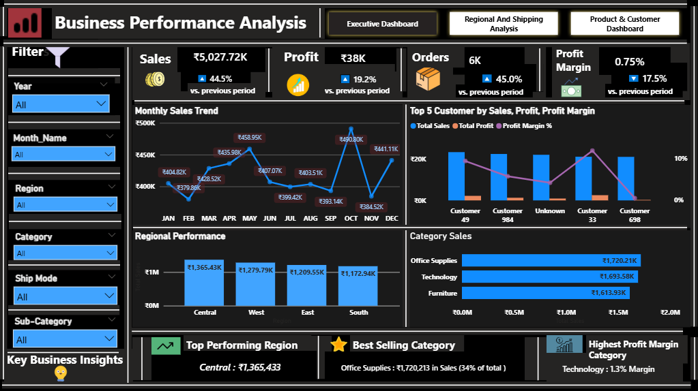
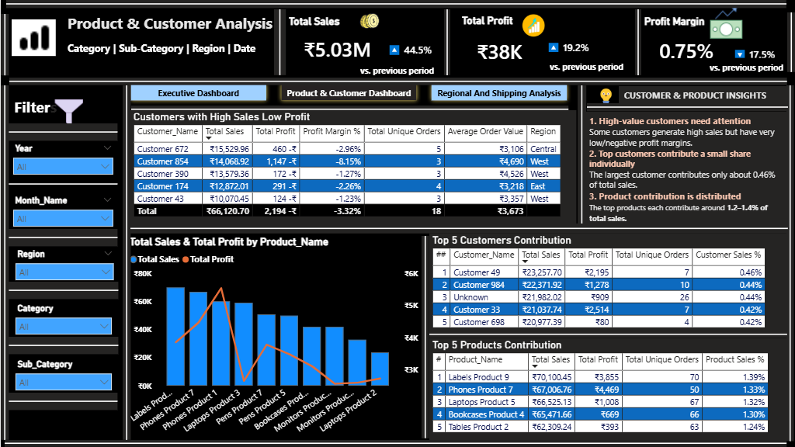
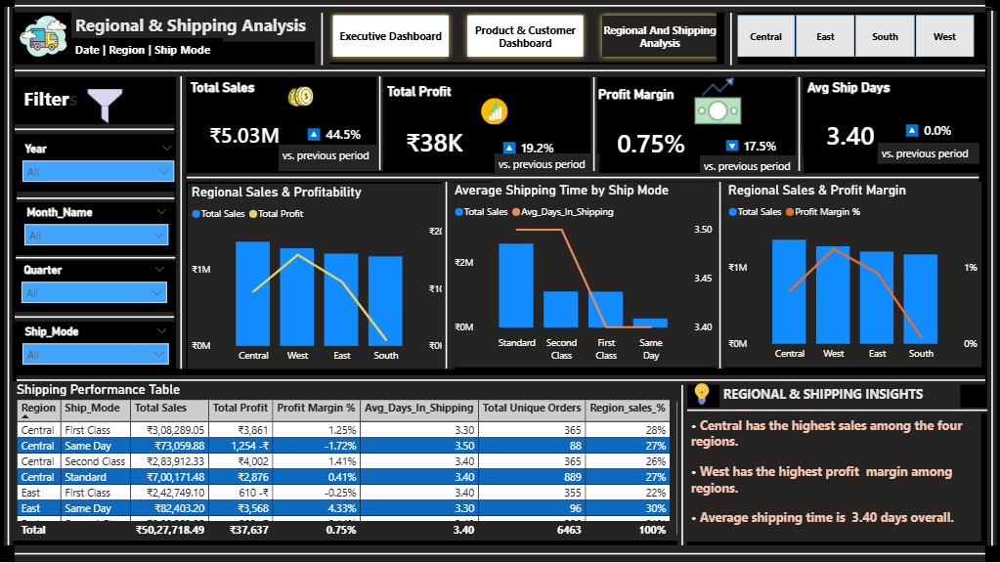

# Retail Business Performance Dashboard | Power BI

An end-to-end Power BI project focused on analyzing retail sales, profitability, customer behavior, product performance, regional performance, and shipping operations.

## Project Overview

The objective of this project is to transform a messy retail dataset into a structured analytical solution using Power BI.

The project follows a complete data analytics workflow, including data cleaning, data validation, data modeling, DAX calculations, business analysis, and interactive dashboard development.

The final report consists of three dashboard pages designed to help management monitor business performance and identify areas requiring attention.

## Business Objectives

- Evaluate overall sales and profitability.
- Identify top-performing and low-performing products.
- Analyze customer contribution and profitability.
- Compare regional business performance.
- Evaluate shipping efficiency and delivery time.
- Support data-driven business decisions.

## Tools & Technologies

| Tool | Purpose |
|---|---|
| Microsoft Power BI | Dashboard development and visualization |
| Power Query | Data cleaning and transformation |
| DAX | Measures and business calculations |
| Microsoft Excel | Dataset preparation and inspection |
| Data Modeling | Star schema and table relationships |

## Dataset

The project uses a retail dataset containing order, customer, product, sales, profit, discount, geographical, and shipping information.

The original dataset intentionally contains data-quality issues to simulate real-world business data.

**Dataset file:** `PowerBI_Project1_Retail_Messy.xlsx`

## Data Cleaning & Preparation

Data cleaning and transformation were performed using Power Query.

Key activities included:

- Identifying and removing exact duplicate records.
- Handling missing values.
- Standardizing inconsistent text values.
- Validating date fields.
- Identifying invalid discount values.
- Investigating zero and invalid quantities.
- Preserving negative sales for return/refund analysis.
- Preserving negative profit to identify loss-making transactions.
- Creating data-quality status columns.
- Validating shipping dates against order dates.

## Data Modeling

A Star Schema data model was implemented to support analytical reporting.

### Fact Table
- Fact_Sales

### Dimension Tables
- Dim_Date
- Dim_Customer
- Dim_Product
- Dim_Location

Relationships were established between the fact and dimension tables using one-to-many relationships and single-direction filtering.

The model supports filtering and analysis across dates, customers, products, and geographical locations.

## DAX Measures & Business Metrics

Key measures developed include:

- Total Sales
- Total Profit
- Total Orders
- Total Customers
- Average Order Value (AOV)
- Profit Margin %
- Previous Month Sales
- Sales Growth %
- Average Days in Shipping
- Region Sales %
- Category Sales %
- Customer Sales Contribution %
- Company Profit Margin

These measures support business performance analysis and interactive reporting.

## Dashboard Pages

### 1. Executive Dashboard

Provides management with an overview of overall business performance.

**Key Performance Indicators:**
- Total Sales
- Total Profit
- Total Orders
- Total Customers
- Profit Margin %
- 
**Visualizations:**
- Top 5 Customers by Sales, Profit & Profit Margin
- Monthly Sales Trend
- Regional Sales Performance
- Sales by Category

### 2. Product & Customer Analysis

Focuses on product performance, customer contribution, and profitability.

**Visualizations:**
- Top 10 Products Name by Total Sales & Total Profit
- Top 5 Customers Contribution
- Top 5 Products Contribution
- Top 5 Customers with High Sales & Low Profit
- Customer & Product Insights

### 3. Regional & Shipping Analysis

Evaluates geographical performance and shipping operations.

**Visualizations:**
- Regional Sales & Profit
- Average Shipping Time by Ship Mode
- Regional Sales & Profit Margin
- Shipping Performance Table
- Regional & Shipping Insights

## Interactive Features

- Date slicer
- Region slicer
- Category slicer
- Ship Mode slicer
- Dynamic dashboard title
- Cross-filtering between visuals
- Conditional formatting
- Page navigation
- Interactive KPI cards and charts

## Dashboard Previews

### Executive Dashboard



### Product & Customer Analysis



### Regional & Shipping Analysis



## Key Skills Demonstrated

- Data Cleaning and Data Validation
- Power Query Transformations
- Star Schema Data Modeling
- DAX Measures and Calculations
- Time Intelligence
- Business Performance Analysis
- Customer and Product Analysis
- Profitability Analysis
- Interactive Dashboard Development
- Data Visualization and Reporting

## Repository Structure

```text
Retail-Business-Performance-Dashboard/
│
├── Dataset/
│   └── PowerBI_Project1_Retail_Messy.xlsx
│
├── Screenshots/
│   ├── Executive_Dashboard.png
│   ├── Product_Customer.png
│   └── Regional_Shipping.png
│
└── README.md
```

## Note

The Power BI `.pbix` file is not included in this repository. Dashboard screenshots are provided for project preview, along with the dataset and project documentation.

## Author

**Shikhar Singh**

Data Analytics Portfolio Project

**Technologies:** Power BI | Power Query | DAX | Excel
